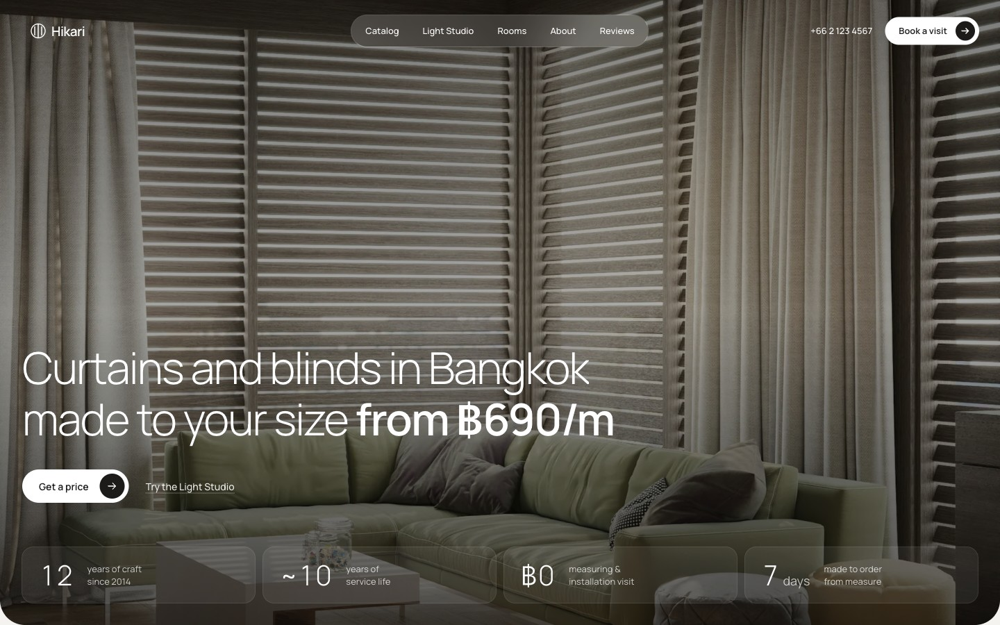
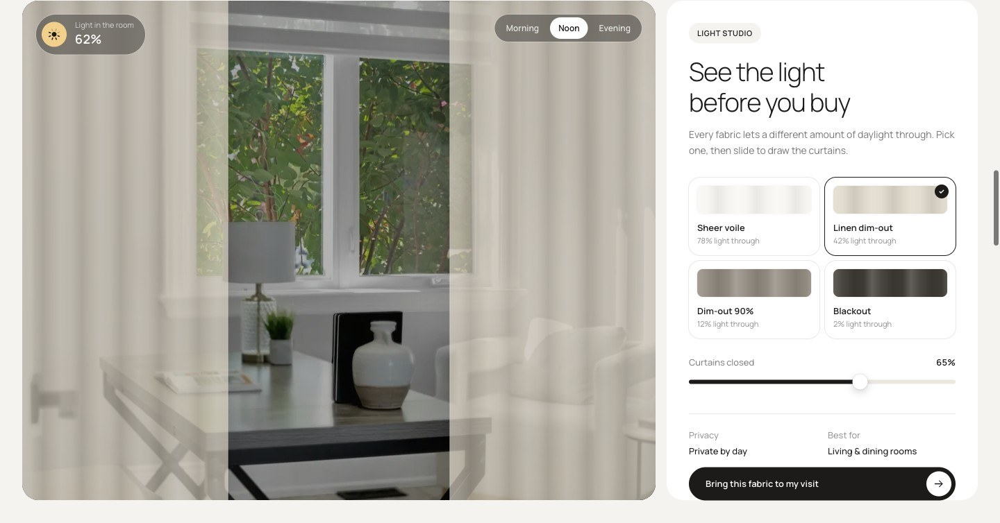
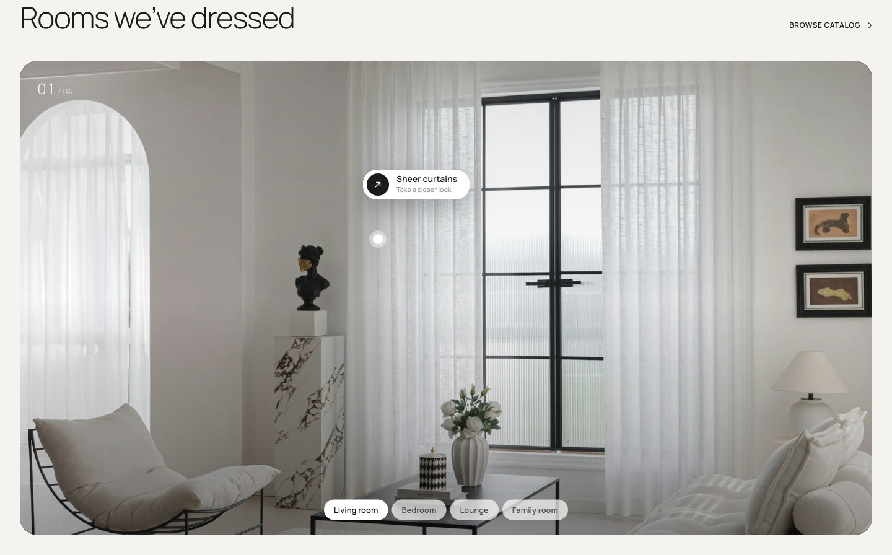
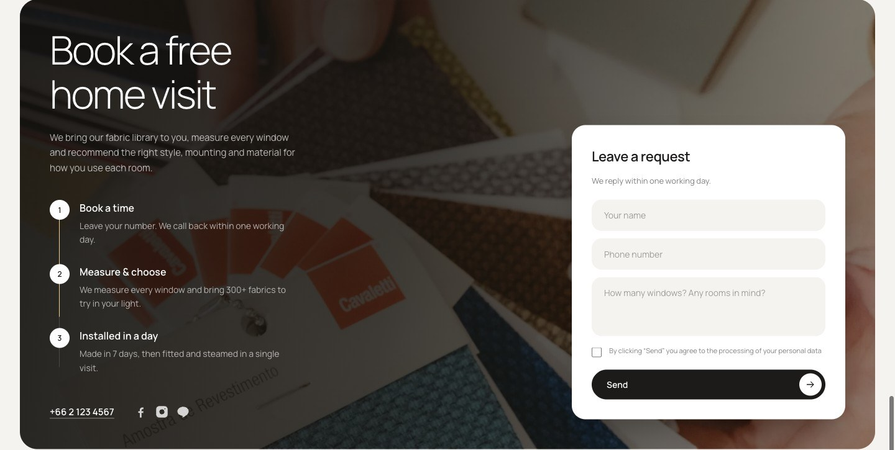
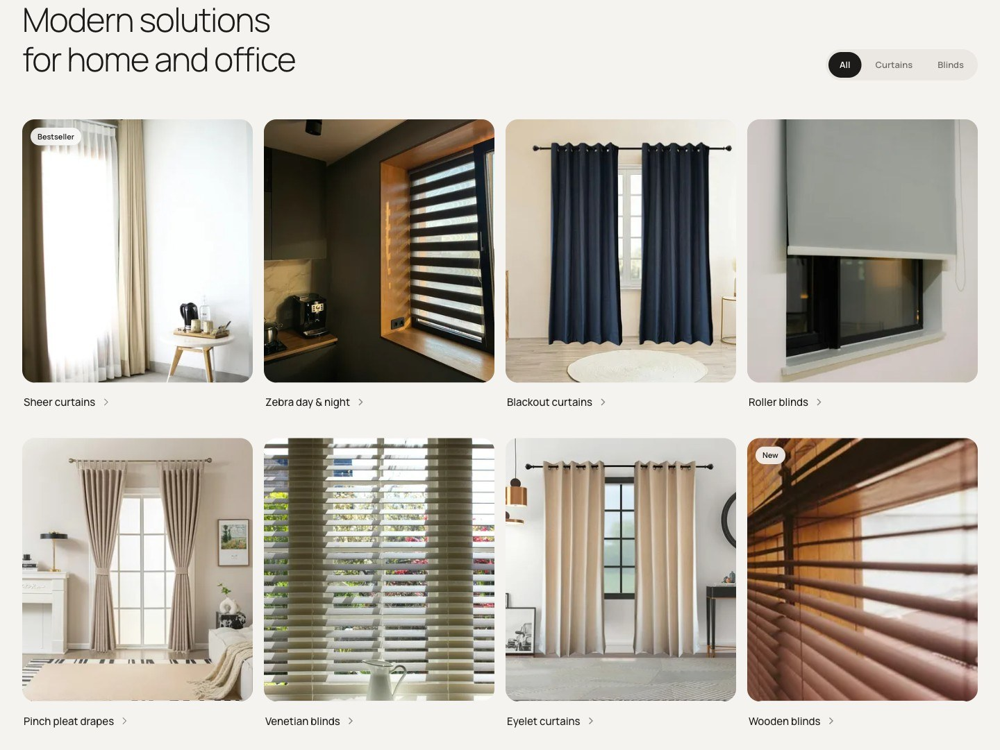

# Hikari

### A curtain and blind studio site where you can see the light before you buy.

Hikari (光) is the Japanese word for light: the soft glow that settles into a room when a window is dressed just right. This is a demo site for a made-to-measure curtain and blind studio in Bangkok, built around that idea. You can browse the catalog, try fabrics in a room and watch how much daylight each one lets through, step through rooms the studio has dressed, and book a free home visit. Nothing is sent anywhere; the booking form only checks what you typed.



| Light Studio | Rooms we've dressed | Book a home visit |
| --- | --- | --- |
|  |  |  |

## Features

- The hero opens out from a framed card while a single beam of light sweeps across the room. The headline comes into focus word by word, the four stats count up, and on a desktop a soft patch of sunlight follows the cursor.
- The header starts as a glass capsule behind the links. Once you scroll it stretches sideways into a full white bar, hides while you scroll down and comes back as soon as you scroll up. On phones the menu opens as a card under the header. The page keeps scrolling behind it, and scrolling closes it: the card rolls up into the header like a blind.
- A strip of service promises runs under the hero.
- The catalog filters between All, Curtains and Blinds. Hovering a card slides up its price and a one-line note; on phones the price sits under the name.
- **Light Studio**: pick one of four fabrics, from sheer voile to blackout, then slide to draw the curtains. The room darkens with a live reading of how much light gets in, and a Morning / Noon / Evening switch changes the light itself, from a soft morning warmth to a dimmer golden evening. On phones the fabric swatches and the slider sit on the photo, so you see every change without scrolling. "Bring this fabric to my visit" carries your fabric down to the booking form.
- **Rooms we've dressed**: four real rooms that play one after another, with a progress line on the active tab. On phones the tabs become a single badge on the photo whose label changes with each room; tap it or swipe the photo for the next one. A marker sits on the curtain in each photo; tap it for the product, a short note and the price. Playback pauses while you hover or have a marker open.
- About numbers count up as they come into view, next to a short timeline of the studio.
- Reviews scroll past in an endless strip.
- The booking section lays out the three steps of a home visit beside the request form, and the step line draws itself as you scroll. A fabric brought over from Light Studio shows up in the form as a chip you can remove.
- In the footer, a band of light passes once over the Hikari wordmark.
- Shared links show a preview card (Open Graph and X) with the headline and a half-drawn curtain, and the site has a favicon and an iPhone home-screen icon.



## Stack

Next.js 16 (App Router, Turbopack, Cache Components), React 19, TypeScript, Tailwind CSS v4, Motion for the animation and Lenis for smooth scrolling. The font is Manrope. Photos come from Unsplash.

## Running it

Needs Node 20.9+ and pnpm.

```bash
pnpm install
pnpm dev
```

`pnpm build && pnpm start` for a production build, `pnpm lint` to lint.

The page builds as fully static. The only setting is `SITE_URL`, the site's public address (for example `SITE_URL=https://hikari.example.com`). Link previews need it so the image URL is absolute. On Vercel you can leave it out, because Next.js uses the project URL.

## Notes

The room markers are placed in photo space, not screen space. Each room stores the point on the curtain as a fraction of the original photo (`spot: { x, y }`). Once the photo loads, `Rooms.tsx` reads its natural aspect ratio and works out where that point ends up under `object-fit: cover` for the current frame size, so the dot stays on the curtain whether the frame is portrait on a phone or wide on a desktop. If there isn't room above the dot for the label, it hangs below instead, and it flips to the left near the right edge.

Light Studio uses one small formula: the light in the room is `time × (1 − closed × (1 − fabric))`, where `fabric` is the share of light that fabric lets through when fully closed. All three values run through springs, so changing any of them eases the room rather than snapping it. The stage keeps a fixed height on desktop, so switching fabric never resizes the photo.

The header background is a single element that moves between two shapes. `Nav.tsx` measures the link list and the full bar with a `ResizeObserver` and animates the background's position and size between them. It does not use a scale transform, because scaling would stretch the rounded ends and the backdrop blur partway through. Hiding on scroll only reacts to a clear direction, so Lenis easing out at the end of a scroll (tiny deltas) doesn't bring the header back by itself.

Lenis is turned off for anyone who prefers reduced motion, and Motion follows the same setting. Motion only drops transforms on its own, so blur and fades are handled by hand: headings appear as plain text instead of rising out of a blur, and the rooms viewer crossfades without blurring. The marquee and the footer sheen stop as well, and the counters show their final value straight away.

Light Studio and the booking form are separate sections, so the fabric hand-off goes through a small window event (`src/lib/fabric-pick.ts`) rather than shared state. The studio announces the fabric when you press the button, and the form listens and shows the chip.

The link preview is drawn in code (`src/app/opengraph-image.tsx`) with Manrope loaded from `src/app/_fonts`. The font read is wrapped in `'use cache'`, because with Cache Components on, a plain async file read would make the image render on every request instead of once at build time.

## Where things are

- `src/app/`: the page, layout, global styles, the icons (`icon.svg`, `favicon.ico`, `apple-icon.png`) and the link preview (`opengraph-image.tsx`, fonts in `_fonts/`)
- `src/components/`: one file per section (`Hero`, `Ticker`, `Catalog`, `LightStudio`, `Rooms`, `About`, `Reasons`, `Reviews`, `Visit`, `Footer`) plus `Nav`, `SmoothScroll` (Lenis and the reduced-motion switch) and `Arrow`
- `src/components/ui/motion.tsx`: `RevealText` (the word-by-word heading reveal) and `CountUp`
- `src/lib/content.ts`: every piece of copy, price and photo on the page
- `src/lib/fabric-pick.ts`: the Light Studio → booking form hand-off

Content changes don't need a component change. To add a product, add an entry to `products` in `src/lib/content.ts` with its `type` (`curtains` or `blinds`) and it appears under the right filter. To add a room, add an entry to `rooms` with the photo and the `spot` where the curtain is. To add a fabric to Light Studio, add it to `fabrics` with how much light it lets through (`pass`, from 0 to 1) and its colour.

## License

© 2026 Hikari by windyoncloud. All rights reserved.
